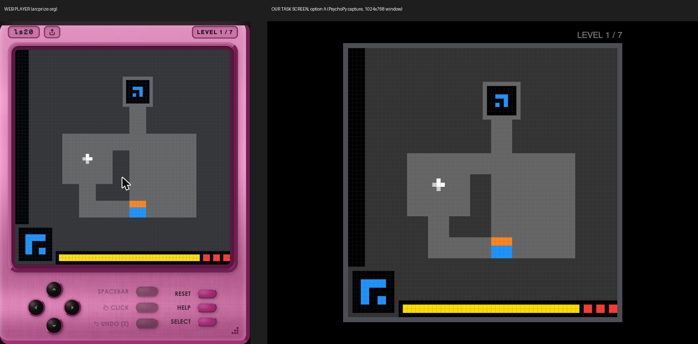

# 2. ARC-AGI-3 code: what it is and where to hook in

Sources: https://docs.arcprize.org/ and the repos in `vendor/` (cloned 2026-10-19, `--depth 1`):

| Repo | What it is | Do we need it? |
|---|---|---|
| `vendor/ARC-AGI` (PyPI `arc-agi` 0.9.9) | The "Toolkit". `Arcade` class, loads games, `env.step()`, scorecards, recordings. | Yes. Main API. |
| `vendor/ARCEngine` (PyPI `arcengine`) | The game engine. `GameAction`, `FrameDataRaw`, `GameState`. | Yes (dependency). |
| `vendor/ARC-AGI-3-Agents` | AI agent templates (LLM, random, swarm). | No. AI-only. |
| `vendor/docs` | Source of docs.arcprize.org. | Reference only. |

`vendor/` is reference only. The project installs `arc-agi` from PyPI (see `pyproject.toml`).

## 2.1 Key facts (checked by running the code)

- **Python 3.12 only.** `arc-agi` needs Python >=3.12. PsychoPy 2026.2.4 needs Python >=3.10,<3.13. So the overlap is Python 3.12. Both install together. (Tested on macOS with `uv`.)
- **Games run locally.** Each game is one Python file plus `metadata.json` in `environment_files/<game>/<version>/`. The Toolkit downloads them once. After that, `OperationMode.OFFLINE` runs with no network.
- **25 public games** are visible with the anonymous key today. `scripts/fetch_games.py` downloaded all 25 into `environment_files/`.
- **Speed:** one `env.step()` takes about 0.1-0.5 ms. The game is never the timing problem.
- **Frame:** always a 64x64 array of colour indices 0-15. The 16 colours are in `arc_agi/rendering.py` (`COLOR_MAP`).
- **Animations:** one action can return many frames (`FrameDataRaw.frame` is a list). Measured maximum per action, random play, 400 steps per game: `g50t` 57 frames, `sb26` 42, `sp80` 28, `bp35` 25.
- **Animation speed:** each game sets its own `default_fps` in its `metadata.json`, from 3 to 30 fps. (Correction: an earlier version of this doc said 5 fps for all games. That value came from a Toolkit default, not the games.) Longest measured animations: `sp80` 28 frames at 10 fps = 2.8 s, `g50t` 57 frames at 30 fps = 1.9 s, `sb26` 42 at 30 fps = 1.4 s.

  | fps | Games |
  |---|---|
  | 30 | cd82, g50t, lf52, ls20, r11l, sb26, sk48, tu93 |
  | 25 | re86 |
  | 20 | bp35, lp85, sc25, su15, vc33 |
  | 15 | dc22, s5i5 |
  | 10 | ka59, sp80, tr87 |
  | 8 / 7 / 6 / 5 / 3 | ft09 / m0r0 / ar25 / cn04, wa30 / tn36 |

  On a 60 Hz screen, 30, 20, 15, 10 fps etc. are whole numbers of refreshes. 25 fps (re86) is 2.4 refreshes, so it plays at 30 fps (2 refreshes) unless the screen runs at 50 or 100 Hz.
- **Actions:** `RESET`, `ACTION1`-`ACTION7`. `ACTION6` is a click and needs `{"x": col, "y": row}` (0-63). Each game uses a subset (`available_actions`). Some games are click-only (`ft09`, `vc33`, `tn36`, `lp85`, `r11l`, `s5i5`). Keyboard-only games: `g50t`, `ls20`, `tr87`, `wa30` (see 2.6).
- **Human keys** in the web player (docs `actions.mdx`): W/↑ = ACTION1, S/↓ = ACTION2, A/← = ACTION3, D/→ = ACTION4, Space/F = ACTION5, mouse click = ACTION6, Z = ACTION7.

Per-game action sets (from `available_actions` after RESET):

| Actions | Games |
|---|---|
| 1-4 (keys only) | ls20, tr87, tu93 (tu93 can need clicks later, see 2.6) |
| 6 only (click only) | vc33, ft09, tn36, lp85, r11l, s5i5 |
| 6, 7 | su15 |
| 5, 6, 7 | sb26 |
| 3, 4, 6, 7 | bp35 |
| 1-4, 6 | ka59, dc22, sc25 |
| 1-4, 6, 7 | sk48, lf52 |
| 1-5 | re86, g50t, wa30 |
| 1-6 | cn04, m0r0, cd82, sp80 |
| 1-7 | ar25 |

For MEG, keys-only games are easiest: a 4- or 5-button response pad is enough. Click games need a pointer device that is safe in the shielded room (see doc 1).

## 2.2 Why we cannot use the Toolkit's own human display

- `render_mode="human"` (`arc_agi/rendering.py`, `render_frames`) opens a new matplotlib figure for **each** step, plays it, then closes it. It does not read the keyboard or the mouse. It is a viewer, not a player.
- Its pixel loop (`frame_to_rgb_array`) is pure Python: **about 15 ms per frame** at scale 4 (measured). That alone is one full frame at 60 Hz. A numpy lookup table does the same in **0.03 ms** (`meg_arc/game.py: frame_to_rgb`, tested equal).
- matplotlib has no vsync-locked flip. We cannot know when a frame reaches the screen.
- The web player at three.arcprize.org is not in the public repos. We cannot put flip-locked triggers in it. Browser timing is also less exact than PsychoPy.

## 2.3 Decision: do not fork the Toolkit. Wrap it.

We do **not** need to edit the ARC-AGI source. The public API gives us all we need:

```python
from arc_agi import Arcade, OperationMode
arc = Arcade(operation_mode=OperationMode.OFFLINE, environments_dir="environment_files")
env = arc.make("ls20", save_recording=True)   # recording = JSONL of every step
obs = env.step(GameAction.ACTION1)            # or env.step(GameAction.ACTION6, data={"x": 10, "y": 20})
obs.frame              # list of 64x64 arrays (1 or more = animation)
obs.state              # GameState.NOT_FINISHED / WIN / GAME_OVER
obs.levels_completed   # goes up by 1 when a level is solved
obs.available_actions  # list of ints
```

Our own PsychoPy loop owns the screen, the input, and the triggers. That is the only place where the flip time is known, so it is the only correct place for triggers.

### Hook points in the Toolkit (if we ever need them)

| Where | What it gives | Use it for |
|---|---|---|
| `arc.make(..., renderer=fn)` → called in `EnvironmentWrapper._set_last_response` (`vendor/ARC-AGI/arc_agi/wrapper.py`, near the line `self.renderer(self._steps, resp)`) | `fn(step, FrameDataRaw)` after every step | Logging only. It runs **before** the frame is on screen, so it is wrong for display triggers. |
| `save_recording=True` → `EnvironmentWrapper._record` (`wrapper.py`) | One JSONL line per step with UTC ISO timestamp, action, x/y, state, frames | Replay of the full game. Our `events.tsv` has a `unix=` anchor so the two files line up. |
| `LocalEnvironmentWrapper.step` (`arc_agi/local_wrapper.py`) | The call into the game | Only if we need to change game logic. We do not. |
| `Arcade.listen_and_serve()` (`arc_agi/server.py`) | Local REST server on port 8001 | Only if a non-Python client (e.g. a browser UI) must play. Then triggers must come from that client. Not recommended. |

If the facility one day needs a fork (for example to change animation speed), subclass `LocalEnvironmentWrapper` in our repo. Do not edit the installed package.

## 2.4 Trial structure ARC-AGI-3 gives us

ARC-AGI-3 is self-paced. There are no fixed trials. Natural events are:

1. Player input (key or click). Exact time comes from the keyboard/pad.
2. First frame of the game's response on screen.
3. Last frame of an animation on screen (the player can act again).
4. Level complete, game over, game win.
5. Game start / game end / rest.

Each event gets its own 8-bit trigger code (doc 3). For analysis, the useful epochs are probably "around input" (planning and motor) and "around response onset" (visual feedback and surprise). Long idle times between inputs are "thinking" periods. This is a research choice, not a code choice.

## 2.5 Web player vs our task screen (checked 2026-10-19, Claude in Chrome)



**The game picture is the same.**
- We read the web player's canvas (`.game-stage-canvas`, 1024 × 1024 px, 16 px per grid square) after one Up move in ls20.
- All 4,096 squares had the same colour as our frame after the same move. 0 differences.
- Every main colour on the web canvas is one of the 16 Toolkit colours (`#333333`, `#666666`, `#000000`, `#ffdc00`, `#1e93ff`, `#f93c31`, `#ff851b`, `#ffffff`, `#cccccc`, ...).

**What the web player adds, and what we copied (option A, chosen 2026-10-19):**

| Web player | Our task screen (option A) |
|---|---|
| Pink hand-held "console" frame with a dark screen border | Black screen. A thin border round the grid in `#4d4d56` (not a palette colour). So black edge squares stay visible. |
| Thin grid lines: 2 px of each 16 px square. The line shows the cell colour as `c × 0.8 + 15`. | Same rule: line colour 75 at 20 % opacity gives exactly `c × 0.8 + 15`. 1 px per 10 px square at `gridPx` 640. |
| Game ID, share button, `LEVEL 1 / 7` counter | `LEVEL 1 / 7` above the top-right corner. It changes only on a new level, on the same frame as trigger 30. |
| On-screen buttons. Unused buttons are dimmed. | Not copied. Highlights would add visual events to the MEG data. |
| START screen | "Press SPACE to start" text |
| — | White/black photodiode square in a corner |

**Bug found and fixed (PsychoPy version):** the frames went to PsychoPy as decimal numbers (-1 to 1). PsychoPy then showed the colours wrong: measured greys 0, 51, 102 came out as 0, 0, 0, so grey squares looked black and orange looked red. Now the frames go as 8-bit images (via PIL). A capture of the window matched our frame in all 4,096 squares. The grid lines and the border also had the right colours. The MATLAB version was not affected, because it passes 8-bit images.

**Not checked:** animation speed and input delay on the web. The web player gets each frame from the ARC server over the internet, so its delay includes the network.

## 2.6 Game choice: the 4 keyboard-only games (decided 2026-10-19)

We plan to use only the 4 games that need no click. A normal mouse cannot go in the MEG room, and these games work with a fibre-optic response pad. No trackball is needed.

The list comes from the `tags` in each game's `metadata.json` ("keyboard" only). The actions come from `available_actions` after RESET.

| Game | Actions | Levels | fps |
|---|---|---|---|
| `g50t` | 1-5 | 7 | 30 |
| `ls20` | 1-4 | 7 | 30 |
| `tr87` | 1-4 | 6 | 10 |
| `wa30` | 1-5 | 9 | 5 |

- **Buttons needed:** 5. That is 4 for the directions (ACTION1-4) and 1 for ACTION5 (`g50t` and `wa30` only). The facility pad probably has 5 buttons.
- **Reset (decided 2026-10-19):** the pad has no reset button.
  - After game over, any button or click resets the level. The log shows `auto_reset` in the note, and the triggers are 9 (RESET) and 19.
  - For a reset during a level, the participant asks on the intercom. The operator then presses `R` on the stimulus PC keyboard.
  - Rejected: two buttons at once for reset. The code would have to wait about 100 ms after each press to check for a second button. That adds delay to every move and blurs the press-to-screen timing.
- **Correction:** earlier docs listed `tu93` as keyboard-only. It starts with actions 1-4, but its metadata tag is "keyboard_click". It can need clicks later, so we do not use it.
- The other 21 games need a click (ACTION6): 8 are click-only and 13 use keys and clicks. They need an MEG-safe trackball. Keep them as an option if the facility has one.

Session command:

```matlab
arc_meg_task('P01', {'ls20', 'tr87', 'g50t', 'wa30'}, triggerMode='io64', triggerAddress='378', eyelink=true)
```

Game order, minutes per game and rest time are still open research decisions.
